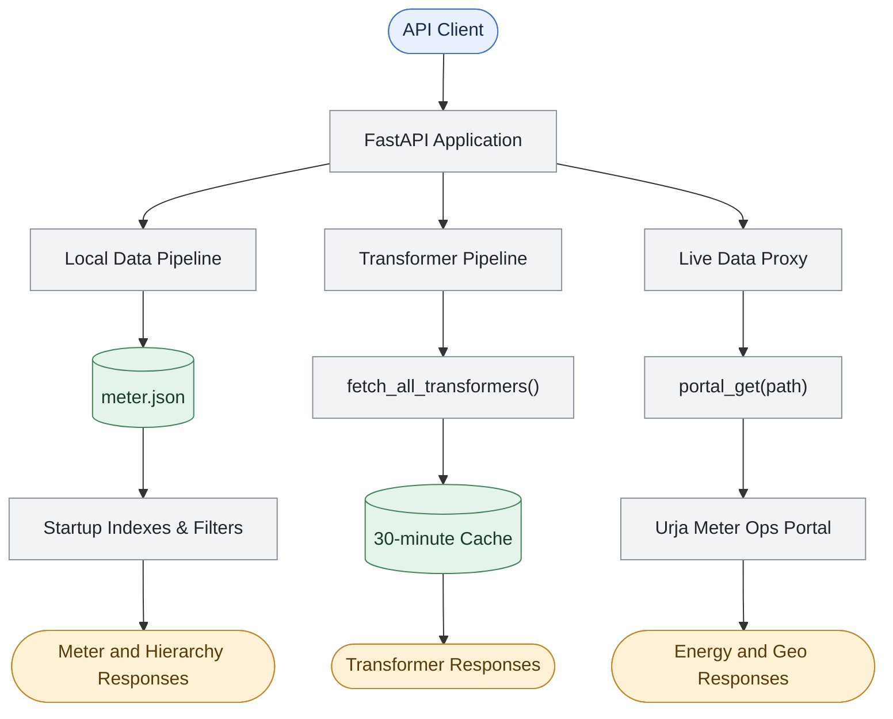
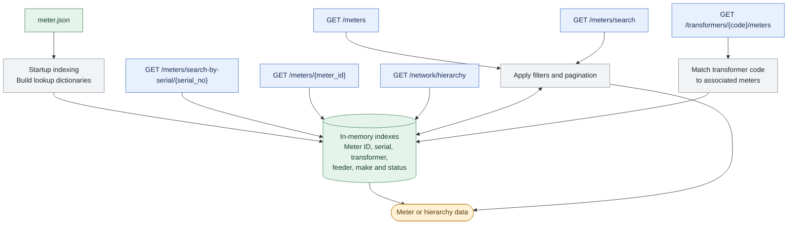
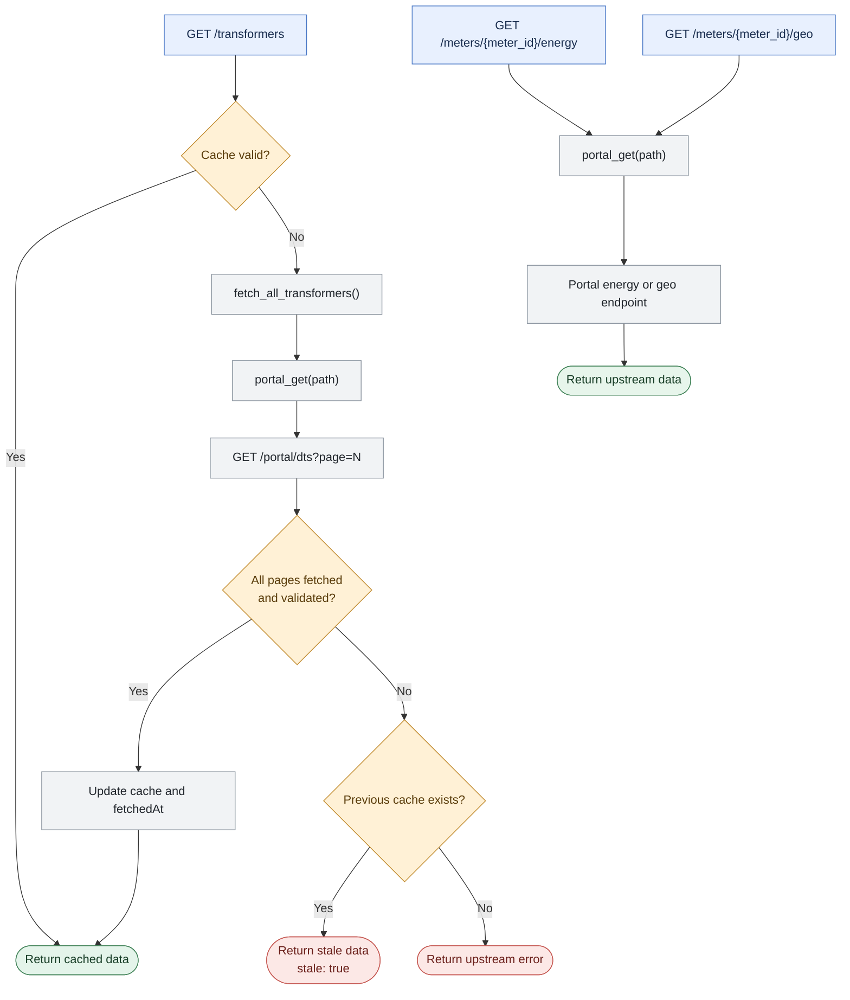

# Flock Energy API — Urja Meter Ops Adapter

A FastAPI service that provides a documented API over the legacy Urja Meter Ops portal. It combines a local meter metadata snapshot with live portal requests for transformer information, energy readings, and meter coordinates.

## Features

- Load and query the meter dataset exported from the portal (`meter.json`).
- Search meters by meter ID or serial number.
- Filter meters by make, installation status/type, phase type, transformer, feeder, and network hierarchy.
- Paginate meter-list results.
- Retrieve all transformer records by following the portal's pagination automatically.
- Cache the complete transformer dataset in memory for 30 minutes.
- If refreshing an expired transformer cache fails, return the last successful dataset with `stale: true` and a `refreshError` explanation.
- Look up meters associated with a transformer.
- Return the distinct network hierarchy found in the local meter snapshot.
- Proxy energy readings and geo coordinates from the portal for known meter IDs.
- Expose interactive API documentation through FastAPI/Swagger UI.
- Include automated tests for API routes, filtering, pagination, cache behavior, stale fallback, and error handling.

## Architecture & Request Flow

The FastAPI adapter provides a unified interface to meter metadata, transformer information, network hierarchy, energy readings, and geographic coordinates. It combines local data processing with authenticated requests to the legacy Urja Meter Ops portal.

### 1. System overview



### 2. Local meter and hierarchy pipeline

These endpoints use the locally loaded `meter.json` snapshot and in-memory indexes. They do not require a live portal request for each lookup.



### 3. Live portal and transformer caching pipeline

Transformer data uses pagination and a 30-minute in-memory cache. Energy and geographic data are fetched from the portal through the shared authenticated request helper.



### Key implementation functions

| Component | Responsibility |
|---|---|
| Startup indexing | Loads meter metadata and builds lookup dictionaries. |
| Meter filtering | Applies search criteria, hierarchy filters, and pagination. |
| `portal_get(path)` | Sends authenticated requests and translates upstream errors. |
| `fetch_all_transformers()` | Fetches transformer pages and validates the complete dataset. |
| Transformer cache | Reuses data for 30 minutes and provides stale fallback after a failed refresh. |

### Data freshness

- **Meter metadata:** loaded from the local snapshot at startup; not automatically refreshed.
- **Transformer metadata:** fetched from the portal and cached for 30 minutes.
- **Energy and geo:** retrieved through live portal requests without adapter-side caching.


### How the pipeline works

1. **Application startup:** `meter.json` is loaded and indexed into dictionaries for efficient meter lookups and filtering.
2. **Meter requests:** The listing, search, detail, and hierarchy endpoints use the local snapshot and in-memory indexes. Filters and pagination are applied before the response is returned.
3. **Transformer requests:** `fetch_all_transformers()` retrieves every page from the portal. Successful results are cached for 30 minutes to reduce repeated upstream calls.
4. **Cache fallback:** If a transformer refresh fails and a previous successful result exists, the API can return that result with `stale: true` and refresh-error information.
5. **Energy and geo requests:** The adapter uses `portal_get(path)` to make authenticated requests to the corresponding upstream endpoint and returns the upstream data through the local API.
6. **Error handling:** Upstream authentication failures, timeouts, and other request failures are translated into appropriate local HTTP errors.

**Important design distinction:** Meter metadata comes from a local snapshot, transformer data is fetched and cached, and energy and geo data are proxied from the portal. These paths have different freshness and availability characteristics.

## Project structure

Expected files in the project directory:

```text
urja/
├── main.py
├── test.py
├── meter.json
├── .env
├── .env.example       # recommended for the repository
├── .gitignore
├── requirements.txt
├── README.md
├── PROTOCOL.md
└── openapi.json       # generated from FastAPI
```

`meter.json` is the exported meter metadata snapshot. The actual `.env` file is local configuration and must not be committed.

## Requirements

- Python 3.10 or newer recommended.
- An authenticated session for the Urja Meter Ops portal to use live portal-backed endpoints.
- The `meter.json` file in the same directory as `main.py`.
- Internet access from the machine running the API for live portal requests.

## Setup

### 1. Open the project directory

In PowerShell:

```powershell
cd D:\urja
```

### 2. Create and activate a virtual environment (recommended)

```powershell
python -m venv .venv
.\.venv\Scripts\Activate.ps1
```

If PowerShell blocks activation, you can run the virtual environment's Python directly, or use:

```powershell
.\.venv\Scripts\python.exe -m pip install -r requirements.txt
```

### 3. Install dependencies

Create `requirements.txt` with:

```text
fastapi
uvicorn[standard]
httpx
python-dotenv
pytest
```

Then install:

```powershell
python -m pip install -r requirements.txt
```

### 4. Configure the portal session

Create a local `.env` file in the same directory as `main.py`:

```dotenv
PORTAL_SESSION_COOKIE=replace_with_your_current_portal_session_token
```

Use the current value of the portal cookie named `__Secure-better-auth.session_token`. Do not include the cookie name in the value; the code supplies that name when making requests.

The session expires and may need to be renewed by logging into the portal and replacing the value. Do not commit `.env` or share the token. Add `.env` to `.gitignore`.

A safe `.env.example` can contain only a placeholder:

```dotenv
PORTAL_SESSION_COOKIE=your_session_token_here
```

### 5. Verify the meter dataset

Ensure `meter.json` is in the same directory as `main.py` and contains the JSON array exported from the portal. The API loads it at startup; if the file is missing or invalid, the application will not start.

## Run the API

From the project directory:

```powershell
python -m uvicorn main:app --reload
```

The API should be available at:

- Base URL: `http://127.0.0.1:8000`
- Interactive Swagger documentation: `http://127.0.0.1:8000/docs`
- ReDoc: `http://127.0.0.1:8000/redoc`
- Health check: `http://127.0.0.1:8000/health`

The first request to `/transformers` fetches all transformer pages from the portal. Subsequent requests use the in-memory cache until it expires.

## API endpoints

All routes below belong to this adapter API, not necessarily to the original portal.

| Method | Endpoint | Description |
|---|---|---|
| `GET` | `/health` | API status and number of locally loaded meter records |
| `GET` | `/meters` | List, filter, search, and paginate meter records |
| `GET` | `/meters/search?q=...` | Partial search by meter ID or serial number |
| `GET` | `/meters/search-by-serial/{serial_no}` | Exact serial-number lookup |
| `GET` | `/meters/{meter_id}` | Retrieve a meter by exact ID |
| `GET` | `/meters/{meter_id}/energy` | Retrieve energy readings from the portal |
| `GET` | `/meters/{meter_id}/geo` | Retrieve geo coordinates from the portal |
| `GET` | `/transformers` | Retrieve all transformers, with 30-minute cache |
| `GET` | `/transformers/{code}/meters` | Retrieve a transformer and its associated meters |
| `GET` | `/network/hierarchy` | Return distinct hierarchy nodes from local meter data |

## Example requests

Examples use PowerShell. You can also paste the URLs into a browser or use Swagger UI at `/docs`.

### Health check

```powershell
Invoke-RestMethod http://127.0.0.1:8000/health
```

### List meters

```powershell
Invoke-RestMethod "http://127.0.0.1:8000/meters?page=1&page_size=20"
```

### Search by meter ID or serial number

```powershell
Invoke-RestMethod "http://127.0.0.1:8000/meters?q=SE33962"
```

Or:

```powershell
Invoke-RestMethod "http://127.0.0.1:8000/meters/search?q=SE33962"
```

Search is partial and case-insensitive for `meterId` and `serialNo`.

### Filter meters

Filters can be combined:

```powershell
Invoke-RestMethod "http://127.0.0.1:8000/meters?make=HPL&install_status=Installed&page=1&page_size=20"
```

Supported optional filters:

- `q` — partial search across meter ID and serial number
- `make`
- `install_status`
- `transformer_code`
- `feeder_code`
- `phase_type`
- `install_type`
- `zone`
- `circle`
- `division`
- `subdivision`
- `substation`
- `page` — defaults to `1`
- `page_size` — defaults to `20`, maximum `100`

Equality filters are case-insensitive. Hierarchy filters match either the node's code or name. `q` is partial matching; other filters are exact-value matching.

### Retrieve one meter

```powershell
Invoke-RestMethod "http://127.0.0.1:8000/meters/J100000"
```

Replace `J100000` with an ID present in your local `meter.json`.

### Get energy readings

```powershell
Invoke-RestMethod "http://127.0.0.1:8000/meters/J100001/energy"
```

This endpoint requires a valid portal session and a meter ID present in the local snapshot.

### Get geographic coordinates

```powershell
Invoke-RestMethod "http://127.0.0.1:8000/meters/J100000/geo"
```

### Get all transformers

```powershell
Invoke-RestMethod "http://127.0.0.1:8000/transformers"
```

The response includes `data`, `total`, `cachedForSeconds`, `fetchedAt`, and `stale`.

Example response shape:

```json
{
  "data": [
    {
      "code": "DT-001",
      "name": "Malviya Nagar DT 1",
      "feederCode": "F-001",
      "capacityKva": 100
    }
  ],
  "total": 40,
  "cachedForSeconds": 1800,
  "fetchedAt": "2026-10-28T10:00:00+00:00",
  "stale": false
}
```

The example is illustrative; the actual response contains the complete transformer dataset.

### Get meters associated with a transformer

```powershell
Invoke-RestMethod "http://127.0.0.1:8000/transformers/DT-007/meters"
```

### Get network hierarchy

```powershell
Invoke-RestMethod "http://127.0.0.1:8000/network/hierarchy"
```

## Caching and stale-data behavior

The complete transformer dataset is fetched from `/portal/dts?page=N`. The API reads `total` and `pageSize` from the portal response and calculates how many pages to request, rather than hardcoding two pages.

- **Cache hit:** if the transformer cache is younger than 30 minutes, return it without a portal fetch.
- **Cache miss/expired cache:** attempt to fetch all pages and validate the complete dataset.
- **Refresh succeeds:** replace the cache and update `fetchedAt`.
- **Refresh fails with an existing cache:** return the last successful dataset with `stale: true` and `refreshError`.
- **Refresh fails with no cache:** return an error rather than inventing data.

The cache is in memory. It is cleared when the process restarts, and multiple server worker processes would maintain separate caches. The 30-minute TTL is a local policy, not a claim about how often the portal's data changes.

Meter metadata is loaded from the local `meter.json` snapshot and indexed at application startup. It is not automatically refreshed from the portal. Energy and geo endpoints proxy live requests and are not cached by this implementation.

## Run the test suite

The test suite uses mocked portal responses for upstream-dependent tests. It does not require a live session token for those tests and should not make real portal requests.

Install the test dependencies if needed:

```powershell
python -m pip install pytest httpx fastapi python-dotenv
```

Run all tests from the project directory:

```powershell
python -m pytest -v test.py
```

The suite covers:

- Health check and meter listing/pagination
- Partial meter search
- Make, installation-status, combined, transformer, and hierarchy filters
- Existing and unknown meter IDs
- Energy and geo proxy behavior with mocked responses
- Network hierarchy
- Multi-page transformer retrieval
- Transformer cache hits and refresh after expiry
- Stale-cache fallback when refresh fails
- Error behavior when no cache exists
- Transformer-to-meter relationships
- Invalid pagination from the portal
- Unknown routes

The recorded run for this project passed **18 tests**. Tests using mocked portal responses validate the adapter's handling of those scenarios, but they are not a substitute for live integration testing.

## Assumptions

- `meter.json` is a valid, locally available export and is the source of meter metadata for the lifetime of the running process.
- The portal's session cookie can be supplied through `PORTAL_SESSION_COOKIE`.
- The portal endpoint `/portal/dts?page=N` uses `total`, `pageSize`, `page`, and `data` consistently enough to paginate through all transformers.
- `dtCode` or `hierarchy.dt.code` on a meter matches the transformer `code`.
- The meter ID supplied to the energy and geo routes should exist in the local meter snapshot.
- Case-insensitive matching is suitable for meter IDs, serial numbers, and equality filters.
- Returning stale transformer metadata is preferable to returning no transformer data during a temporary refresh failure, provided the response clearly identifies it as stale.

## Engineering trade-offs

- **Local JSON snapshot instead of a database:** simple to set up and sufficient for the observed dataset size. The trade-off is that the snapshot does not automatically reflect later portal changes.
- **In-memory indexes:** fast exact lookups and common filters without extra services. They are rebuilt on process startup and consume a small amount of memory.
- **In-memory transformer cache:** avoids repeated upstream requests and adds no Redis dependency. It is per process and resets on restart.
- **Stale-if-refresh-fails:** improves availability while explicitly marking old data. Clients must inspect `stale` and `fetchedAt`.
- **Paginated transformer retrieval:** uses the confirmed portal API and dynamically calculates page count. It requires multiple requests and can fail if pagination changes mid-fetch.
- **Direct proxy for energy and geo:** avoids inventing or storing a separate cache policy for these data types. It means those endpoints depend on portal availability and session validity.
- **No automatic login/session refresh:** no supported refresh flow was confirmed, so the implementation asks the operator to renew the session.
- **Simple FastAPI routes:** easy to inspect and document for a take-home assignment; the current code has not been split into a multi-module architecture.

## Intentionally skipped

- Redis or other distributed caching infrastructure.
- Persistent database storage for meter/transformer data.
- Automatic portal login or session renewal.
- Energy-reading and geo caching; their freshness and invalidation policies have not been implemented.
- Automatic refresh of `meter.json`.
- A single-request transformer bulk export, because one has not been confirmed.
- Bulk energy retrieval across all meters, because no such route has been confirmed.
- Retry/backoff policies and background refresh scheduling.
- Authentication/authorization for clients of this local API; do not expose the development server publicly without adding suitable protection.
- A frontend UI; Swagger UI is used for interactive exploration.

## Future improvements

1. Add integration tests against a controlled portal session, separate from the deterministic mocked unit tests.
2. Add structured logging and metrics for cache hits, misses, refresh failures, and stale responses.
3. Add an explicit cache-status endpoint or optional cache metadata to make freshness easier to inspect.
4. Consider background refresh or bounded retry/backoff for transient portal failures.
5. Define and test freshness policies before caching energy readings; use both retrieval time and the latest source reading timestamp.
6. Investigate a supported programmatic way to refresh the meter export.
7. Continue investigating whether bulk energy retrieval or a one-request transformer export exists.
8. Add response models and stronger validation for upstream JSON.
9. Add client-side authentication/rate limiting before exposing the API beyond localhost.
10. Add CI to run `python -m pytest -v test.py` on each change.

## Reflection

### 1. Understanding the Existing Portal
- I inspected the portal's UI, network requests, authenticated endpoints, and exported meter JSON before designing the adapter.
- This helped me distinguish local meter metadata from live transformer, energy, and geographic data.

### 2. Data Discovery and Relationships
- The portal's export provided a snapshot of **403 meter records**, but energy readings had to be retrieved separately.
- Transformer data was paginated, so I implemented pagination using the portal's metadata rather than relying on the first page.
- I linked meters to transformers using their transformer codes to expose these relationships through the API.

### 3. Automatic Authentication
- Initially, the adapter required a manually copied session cookie, which could expire while the application was running.
- I updated it to log in using credentials stored in environment variables, retain the session cookie, and attempt re-authentication when an upstream request returns an authentication error.
- The failed request is retried only once to avoid infinite retry loops, and credentials are kept out of the source code.

### 4. Caching and Data Freshness
- I implemented a **30-minute in-memory cache** for transformer data to reduce repeated portal requests.
- If refreshing the cache fails after a successful fetch, the adapter can serve the last available dataset and mark the response as stale.
- Meter metadata remains a local snapshot, while energy readings and geographic data are fetched from the portal when requested.

### 5. Testing and Reliability
- The automated test suite passed, covering API routes, filtering, pagination, meter-to-transformer relationships, and cache failure scenarios.
- The tests use mocked portal responses, so live authentication and integration must be verified separately.

### 6. Limitations and Future Improvements
- Meter metadata does not automatically refresh, and the in-memory transformer cache resets when the application restarts.
- I would improve the adapter with controlled integration tests, stronger response validation, structured logging, and monitoring for upstream failures and stale data.
- I would also investigate supported mechanisms for refreshing meter metadata and maintaining authentication rather than assuming undocumented portal endpoints exist.

### Key Takeaway
This project reinforced the importance of separating observed system behavior from assumptions. I chose a small, testable architecture that addresses the requirements while documenting its limitations and leaving room for future improvements.
## Related documentation

- [`PROTOCOL.md`](PROTOCOL.md) — detailed portal investigation, observed endpoints, data fields, authentication behavior, and unverified questions.
- [`openapi.json`](openapi.json) — OpenAPI specification for this adapter (generate it from the running app if it is not present).
